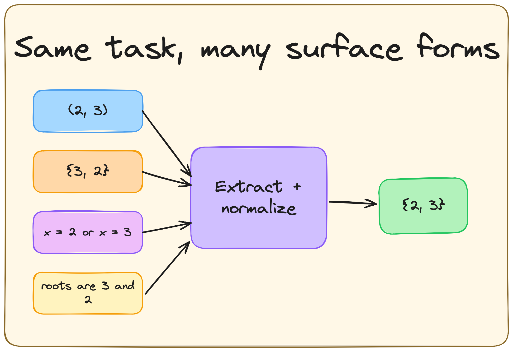
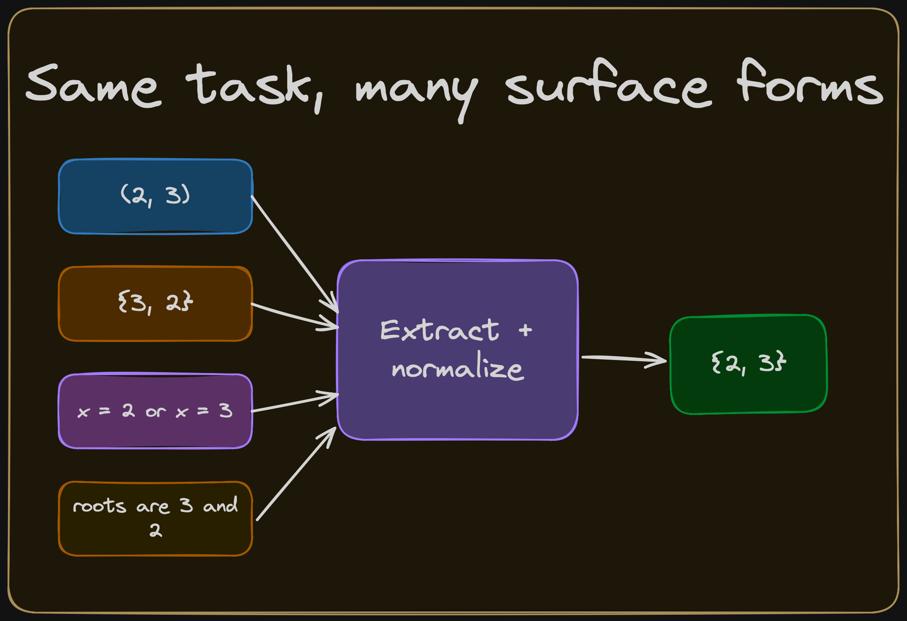

# Outcome Rewards

{width="80%" fig-align="center"}

## Chapter Map

- Explain outcome verifiers.

## How outcome verifiers are implemented

A useful abstraction of outcome-verification pipelines is in three steps:

1. **Extract.**

   - Parse the model's raw text to isolate the checked artifact. This depends on the output contract: the `<answer>` tags in our scaffold, `\boxed{}` in many math benchmarks, the final code block in a generation task, or the proof term in a formal system.

2. **Canonicalize.**

   - Map the extracted artifact to a representation that is stable under harmless surface variation. In math this can mean parsing `(2,3)`, `{3,2}`, and `x=2, x=3` into the same set object.

3. **Reward.**

   - Assign a reward value. The simplest version is binary: 1 if correct, 0 otherwise. Partial credit for passing some but not all tests, or a continuous score from a symbolic similarity metric are possible too.

Current RLVR frameworks differ in how they represent the `extract -> canonicalize -> reward` interface, and it also depends on the domain you're working in; see the Hugging Face reinforcement learning environments explainer for a comprehensive rundown [@kolavi2026rlenvironments]. If we consider math-style tasks, those reward functions often delegate most work to answer-verification libraries such as Math-Verify, whose documented grading architecture is explicit: answer extraction, conversion to a common representation, and gold comparison [@kydlicek2025mathverify].

## A Rollout {#sec-ch2-rollout}

A rollout is a sample from the current policy on a prompt, example:

**Prompt**

Solve the equation: $x^2-5x+6=0$.

**Completion**

```text
<think>
We can factor the quadratic: x^2 - 5x + 6 = (x-2)(x-3).
Set each factor to zero:
x - 2 = 0 -> x = 2
x - 3 = 0 -> x = 3
The solutions are 2 and 3.
</think>

<answer>
(2,3)
</answer>
```

**Outcome reward check (for RLVR).**

The verifier reads between `<answer>...</answer>`, normalizes/canonicalizes the answer, and checks it against the ground-truth set.[^ch2-deepseek-r1-template]

$$
r(\text{input},\text{output})=
\begin{cases}
1 & \text{if } \operatorname{canon}\bigl(\operatorname{extract}_{\mathrm{ans}}(\text{output})\bigr)=\{2,3\},\\
0 & \text{otherwise.}
\end{cases}
$$ {#eq-ch2-binary-check}

If the model deviates from the output contract e.g. omits `<answer>...</answer>`, the verifier can assign an incorrect reward even when the underlying solution is correct.

::: {#fig-answer-normalization}

::: {.content-visible when-format="html"}
{.light-content}

{.dark-content}
:::

::: {.content-visible when-format="pdf"}

:::

If canonicalization fails, algebraically correct answers can receive the wrong reward. The practical work is to parse the answer region, strip surface variation, and canonicalize set structure or ordering before verification.
:::

## A minimal outcome verifier

A toy math verifier for the quadratic example looks like this:

```python
import re

ANSWER_RE = re.compile(r"<answer>\s*(.*?)\s*</answer>", re.DOTALL)

def extract_answer(completion: str) -> str | None:
    match = ANSWER_RE.search(completion)
    return None if match is None else match.group(1).strip()

def canonicalize_answer(answer: str) -> tuple[str, ...]:
    text = answer.strip().lower()
    text = re.sub(r"\\?[{}()]", "", text)
    text = re.sub(r"^roots?\s+are\s+", "", text)
    text = re.sub(r"\bx\s*(?:=|\\in)\s*", "", text)
    text = re.sub(r"\b(?:or|and)\b", ",", text)
    pieces = [piece.strip() for piece in text.split(",")]
    number = re.compile(r"-?\d+(?:\.\d+)?")
    if not pieces or any(not number.fullmatch(piece) for piece in pieces):
        return ()
    return tuple(sorted(set(pieces), key=float))

def outcome_reward(completion: str, gold: tuple[str, ...] = ("2", "3")) -> float:
    answer = extract_answer(completion)
    if answer is None:
        return 0.0
    candidate = canonicalize_answer(answer)
    expected = tuple(sorted(set(gold), key=float))
    return float(candidate == expected)
```

## Outcome check, full-trajectory update

Although verifiers only consider the outcome, the optimizer updates the entire trajectory. In REINFORCE-style algorithms (including GRPO), the scalar reward (or an advantage derived from it) is used to upweight or downweight the log-probability of every token in the completion. If the advantage relative to the sampled group is positive, the whole chain of reasoning that produced it becomes more likely; the converse is also true!

To quote Andrej Karpathy on his October 17, 2025 appearance on the Dwarkesh podcast [@patel2025karpathyagi]:

> Every single one of those incorrect things you did, as long as you got to the correct solution, will be upweighted as "Do more of this." It's terrible. It's noise.
>
> You've done all this work only to find, at the end, you get a single number of like, "Oh, you did correct." Based on that, you weigh that entire trajectory as like, upweight or downweight. The way I like to put it is you're sucking supervision through a straw. You've done all this work that could be a minute of rollout, and you're sucking the bits of supervision of the final reward signal through a straw and you're broadcasting that across the entire trajectory and using that to upweight or downweight that trajectory. It's just stupid and crazy.
>
> A human would never do this. Number one, a human would never do hundreds of rollouts. Number two, when a person finds a solution, they will have a pretty complicated process of review of, "Okay, I think these parts I did well, these parts I did not do that well. I should probably do this or that." They think through things. There's nothing in current LLMs that does this. There's no equivalent of it. But I do see papers popping out that are trying to do this because it's obvious to everyone in the field.

One cannot deny the success of outcome-based RLVR, but in this regard, it is a blunt instrument that assigns one scalar per completion. This works well in practice because over many rollouts and many problems, tokens that consistently appear in correct trajectories get reinforced and tokens that appear in incorrect trajectories get suppressed, but it also means that outcome rewards cannot isolate one step as good or bad. That distinction is what process rewards (Chapter 3) provide.

::: {#fig-ch2-outcome-full-trajectory-update fig-cap="Example from @sec-ch2-rollout continued."}

::: {.content-visible when-format="html"}

```{=html}
<div class="ds-widget" id="ds-widget">
  <div class="ds-head">
    <div class="ds-controls">
      <div class="ds-tabs" role="tablist" aria-label="Outcome update examples">
        <button class="ds-tab ds-active" role="tab" aria-selected="true" data-mode="success">Success</button>
        <button class="ds-tab" role="tab" aria-selected="false" data-mode="failure">Failure</button>
      </div>
      <div class="ds-reward-badge" id="ds-reward-badge" aria-live="polite"></div>
    </div>
  </div>

  <div class="ds-chain" id="ds-chain"></div>

  <div class="ds-legend">
    <span class="ds-legend-item"><span class="ds-swatch ds-swatch-sampled"></span> sampled option</span>
    <span class="ds-legend-item"><span class="ds-swatch ds-swatch-other"></span> unsampled options</span>
  </div>

</div>

<script>
(() => {
  const states = {
    success: {
      rewardText: "Reward = 1; A > 0",
      rewardClass: "ds-reward-success",
      direction: "up",
      slots: [
        { title: "1. factor", sampled: "(x-2)(x-3)", sampledIndex: 3, probs: [0.12, 0.10, 0.15, 0.63] },
        { title: "2. first root", sampled: "x = 2", sampledIndex: 0, probs: [0.61, 0.12, 0.14, 0.13] },
        { title: "3. second root", sampled: "x = 3", sampledIndex: 2, probs: [0.14, 0.11, 0.60, 0.15] },
        { title: "4. collect", sampled: "{2,3}", sampledIndex: 1, probs: [0.16, 0.58, 0.11, 0.15] },
        { title: "5. answer", sampled: "<answer>{2,3}</answer>", sampledIndex: 0, probs: [0.63, 0.12, 0.13, 0.12], checked: true }
      ]
    },
    failure: {
      rewardText: "Reward = 0; A < 0",
      rewardClass: "ds-reward-failure",
      direction: "down",
      slots: [
        { title: "1. factor", sampled: "(x-2)(x-3)", sampledIndex: 3, probs: [0.18, 0.17, 0.21, 0.44] },
        { title: "2. first root", sampled: "x = 2", sampledIndex: 0, probs: [0.41, 0.19, 0.21, 0.19] },
        { title: "3. second root", sampled: "x = 3", sampledIndex: 2, probs: [0.20, 0.18, 0.41, 0.21] },
        { title: "4. collect", sampled: "{2,3}", sampledIndex: 1, probs: [0.19, 0.45, 0.17, 0.19] },
        { title: "5. answer", sampled: "<answer>x = 2</answer>", sampledIndex: 1, probs: [0.19, 0.45, 0.18, 0.18], checked: true }
      ]
    }
  };

  const chain = document.getElementById("ds-chain");
  const slotEls = [];

  states.success.slots.forEach(() => {
    const slot = document.createElement("div");
    slot.className = "ds-slot";

    const title = document.createElement("div");
    title.className = "ds-slot-title";

    const chart = document.createElement("div");
    chart.className = "ds-chart";

    const checkLabel = document.createElement("div");
    checkLabel.className = "ds-check-label";
    checkLabel.textContent = "Verifier";
    chart.appendChild(checkLabel);

    const barsWrap = document.createElement("div");
    barsWrap.className = "ds-bars";
    const bars = [];
    for (let i = 0; i < 4; i += 1) {
      const bar = document.createElement("div");
      bar.className = "ds-bar";
      barsWrap.appendChild(bar);
      bars.push(bar);
    }
    chart.appendChild(barsWrap);

    const sampledRow = document.createElement("div");
    sampledRow.className = "ds-sampled-row";

    const arrow = document.createElement("div");
    arrow.className = "ds-update-arrow";

    const sampledLabel = document.createElement("div");
    sampledLabel.className = "ds-sampled-label";

    sampledRow.appendChild(arrow);
    sampledRow.appendChild(sampledLabel);

    slot.appendChild(title);
    slot.appendChild(chart);
    slot.appendChild(sampledRow);
    chain.appendChild(slot);

    slotEls.push({ slot, title, bars, sampledLabel, arrow, checkLabel });
  });

  function render(mode) {
    const state = states[mode];
    slotEls.forEach((slotEl, idx) => {
      const slot = state.slots[idx];
      slotEl.title.textContent = slot.title;
      slotEl.sampledLabel.textContent = slot.sampled;
      slotEl.arrow.textContent = state.direction === "up" ? "↑" : "↓";
      slotEl.arrow.className = "ds-update-arrow " + (state.direction === "up" ? "ds-update-up" : "ds-update-down");
      slotEl.slot.classList.toggle("ds-checked", Boolean(slot.checked));
      slotEl.checkLabel.style.display = slot.checked ? "inline-flex" : "none";

      slotEl.bars.forEach((bar, barIdx) => {
        bar.style.height = `${slot.probs[barIdx] * 100}%`;
        bar.classList.toggle("is-sampled", barIdx === slot.sampledIndex);
        bar.style.opacity = barIdx === slot.sampledIndex ? "1" : "0.72";
        bar.style.transform = barIdx === slot.sampledIndex ? "translateY(-1px)" : "none";
      });
    });

    const badge = document.getElementById("ds-reward-badge");
    badge.textContent = state.rewardText;
    badge.className = "ds-reward-badge " + state.rewardClass;

    document.querySelectorAll(".ds-tab").forEach((button) => {
      const active = button.dataset.mode === mode;
      button.classList.toggle("ds-active", active);
      button.setAttribute("aria-selected", active ? "true" : "false");
    });
  }

  document.querySelectorAll(".ds-tab").forEach((button) => {
    button.addEventListener("click", () => render(button.dataset.mode));
  });

  render("success");
})();
</script>
```

:::

::: {.content-visible when-format="pdf"}

```text
Successful trajectory
factor as (x-2)(x-3)
  -> set x = 2
  -> set x = 3
  -> collect {2,3}
  -> <answer>{2,3}</answer>
checked artifact: PASS (reward = 1)
group-relative advantage: A > 0
update over sampled tokens:  ↑  ↑  ↑  ↑  ↑

Unsuccessful trajectory
factor as (x-2)(x-3)
  -> set x = 2
  -> set x = 3
  -> collect {2,3}
  -> <answer>x = 2</answer>
checked artifact: FAIL (reward = 0)
group-relative advantage: A < 0
update over sampled tokens:  ↓  ↓  ↓  ↓  ↓
```

:::

:::

## Domain-specific considerations


| Domain       | What we're verifying                                 | Typical verifier                                                                                                              | Main bottleneck                                 |
| ------------ | ---------------------------------------------- | ----------------------------------------------------------------------------------------------------------------------------- | ----------------------------------------------- |
| Math         | Final answer or structured mathematical object | Answer extraction, canonicalization, symbolic equivalence, or reference comparison [@shao2024deepseekmath; @deepseekai2025r1] | Output contracts and normalization              |
| Code         | Program, patch, or execution result            | Sandboxed tests, hidden tests, timeouts, and optional static checks [@le2022coderl; @shojaee2023ppocoder; @liu2023rltf]       | Test coverage and flaky infrastructure          |
| Formal proof | Proof term, tactic trace, or proof state       | Proof-assistant kernel e.g. Lean [@xin2024deepseekprover; @xin2024deepseekproverv15]                                         | Search, decomposition, and formalization burden |

## Failure modes

- An extractor can reward obedience to formatting conventions more than correctness.
- A canonicalizer can fail to merge equivalent answers or merge distinct answers into one canonical form.
- A verifier can evaluate the wrong capability due to reward hacking.

[^ch2-deepseek-r1-template]: DeepSeek-R1-Zero uses `<think>`/`<answer>` separators and applies task-specific response-shape constraints for reward parsing, including boxed final outputs when useful for deterministic math verification [@deepseekai2025r1].
